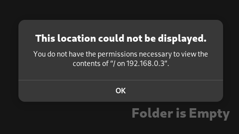

# GMM (GSConnect / KDE Connect Mount Manager) 2.0

<p align="left">
  <a href="https://www.kernel.org"></a>
  <a href="https://www.python.org"></a>
  <a href="#"></a>
  <a href="#"></a>
</p>

Seamless, zero-polling Android storage integration for Linux desktops. Automatically organizes storage volumes into clean local directories and file manager bookmarks when connecting via **GSConnect** or **KDE Connect**.

[Quick Install](#-one-line-install-no-git-clone-needed) • [Why GMM?](#-why-gmm) • [Features](#-features-in-20) • [CLI Commands](#-cli-usage) • [Configuration](#-configuration) • [FAQ](#-troubleshooting--faq)

---

## ⚡ One-Line Install (No Git Clone Needed)

Install and enable GMM instantly via your terminal:

```bash
curl -fsSL https://raw.githubusercontent.com/vjaykrsna/gsconnect-mount-manager/main/install.sh | bash
```

> **Note:** Run as regular user (do **NOT** use `sudo`). Installs `gmm` to `~/.local/bin/gmm` and enables the systemd user service.

<details>
<summary><b>Or install via Git Clone</b></summary>

```bash
git clone https://github.com/vjaykrsna/gsconnect-mount-manager.git
cd gsconnect-mount-manager
chmod +x install.sh
./install.sh
```
</details>

---

## 🎯 Why GMM?

When connecting an Android device to a Linux desktop via GSConnect or KDE Connect, file managers (Nautilus, Nemo, Dolphin) attempt to open the device's SFTP root directory (`/`). Modern Android restricts root filesystem browsing, causing Nautilus to fail:


*Standard GNOME Files error when opening unmanaged Android SFTP root (`/`)*

### The Difference with GMM

| Without GMM | With GMM 2.0 |
| :--- | :--- |
| ❌ "Could not display location" error in file manager | ✅ Direct, instant access to phone storage |
| ❌ Broken bookmarks whenever phone changes Wi-Fi IP | ✅ Local `~/Devices/` folder immune to IP changes |
| ❌ Manually pressing `Ctrl + L` & typing `/storage/emulated/0` | ✅ Zero-click automated mounting |
| ❌ MicroSD cards buried under random hex UUIDs | ✅ Auto-discovered as `SDCard` |
| ❌ Battery-draining polling scripts | ✅ **0% CPU at idle** using native kernel/GVfs events |

---

## ✨ Features in 2.0

* **⚡ True Event-Driven (Zero Polling)** – Uses native `Gio.VolumeMonitor` signals. **0% CPU at idle**, zero background subshell forks.
* **📱 True Multi-Device Support** – Seamlessly tracks multiple phones and tablets connected simultaneously without state collisions.
* **💾 Smart Storage Auto-Discovery** – Automatically discovers Internal Storage (`/storage/emulated/0`) and MicroSD/USB-OTG drives (detecting volume UUIDs like `3C82-16F4`) out of the box.
* **🔖 Dual-Mode Bookmarking** – Provides direct SFTP bookmarks for Nautilus plus local directory bookmarks immune to Wi-Fi IP changes.
* **🛠️ Unified `gmm` CLI** – Built-in management tool (`status`, `list`, `mount`, `unmount`, `clean`, `doctor`, `uninstall`).
* **🔔 Desktop Notifications** – Optional notifications when devices mount/unmount with quick-open folder support.
* **⚙️ Modern TOML Configuration** – Clean, human-readable settings via `~/.config/gmm/config.toml`.
* **🛡️ Atomic & Safe** – File-locked atomic bookmark writes prevent file corruption from concurrent file manager edits.

---

## 📁 Directory Layout

```
~/Devices/
└── Pixel_7/
    ├── Internal -> /run/user/1000/gvfs/sftp:.../storage/emulated/0
    └── SDCard   -> /run/user/1000/gvfs/sftp:.../storage/3C82-16F4
```

* **In File Managers (Nautilus, Nemo, Dolphin, Thunar):**
  * Click **"Pixel_7"** in the sidebar $\rightarrow$ Opens the device container folder.
  * Click **"Pixel_7/Internal"** or **"Pixel_7/SDCard"** $\rightarrow$ Opens the storage partitions directly.
* **In Terminal / Scripts / IDEs:**
  ```bash
  cd ~/Devices/Pixel_7/Internal
  ```

---

## 💻 CLI Usage

GMM includes a command-line tool `gmm` installed to `~/.local/bin/gmm`:

```bash
# View active daemon status, connected devices, mounts, and bookmarks
gmm status

# List paired devices across GSConnect and KDE Connect
gmm list

# Trigger mount for a device
gmm mount "Pixel 7"

# Unmount device and clean up symlinks
gmm unmount "Pixel 7"

# Clean up any stale symlinks or dead bookmarks
gmm clean

# Run system health diagnostics
gmm doctor

# Uninstall GMM and remove background service
gmm uninstall
```

### Terminal Status Preview

```text
$ gmm status
GMM (GSConnect / KDE Connect Mount Manager) v2.0.0
──────────────────────────────────────────────────
Base Directory : /home/user/Devices
Bookmark Mode  : both
Daemon Service : ● Active (running)

Active SFTP Mounts:
  • Pixel 7
    URI  : sftp://192.168.1.50:1739/
    Path : /run/user/1000/gvfs/sftp:host=192.168.1.50,port=1739/

Managed Device Folders:
  • Pixel_7/ [Internal, SDCard]

Current GTK Bookmarks:
  • file:///home/user/Devices/Pixel_7 Pixel_7
  • sftp://192.168.1.50:1739/storage/emulated/0 Pixel_7/Internal
  • sftp://192.168.1.50:1739/storage/3C82-16F4 Pixel_7/SDCard
```

---

## ⚙️ Configuration

Settings are stored in `~/.config/gmm/config.toml`:

```toml
[general]
# Base directory where device folders are organized (default: "~/Devices")
mount_structure_dir = "~/Devices"

# Bookmark mode in GTK file manager:
# "both"       - Direct SFTP bookmarks AND local folder bookmarks (immune to IP changes)
# "sftp_only"  - Direct SFTP bookmarks only
# "local_only" - Local directory bookmarks only
# "none"       - Disable bookmark creation
bookmark_mode = "both"

# Show desktop notifications when storage is connected/disconnected
notifications = true

# Automatically trigger SFTP mount when device connects to Wi-Fi
auto_mount = true

# Clean up empty device folders and dangling links on disconnect
auto_cleanup = true

[storage]
# Automatically discover Internal storage and SD Card UUIDs
auto_discover = true

# Exclude internal Android pseudo-directories
exclude_directories = ["self", "knox", "legacy", "sdcard"]

# Custom storage paths (optional override). Format: ["/path:Label"]
custom_paths = []

[logging]
level = "INFO"
```

To apply changes, restart the background service:
```bash
systemctl --user restart gmm.service
```

---

## 🔧 Service Management

GMM runs as a background `systemd` user service:

```bash
# Check service status
systemctl --user status gmm

# Follow live service logs
journalctl --user -u gmm -f

# Start / Stop / Restart
systemctl --user start gmm
systemctl --user stop gmm
systemctl --user restart gmm
```

---

## ❓ Troubleshooting & FAQ

### 1. Device is paired, but storage does not appear
* On your Android device, open **KDE Connect** $\rightarrow$ tap your computer $\rightarrow$ **Plugin Settings**.
* Ensure **Filesystem expose** (Storage access) is enabled and granted storage permissions.

### 2. Can I change the base folder from `~/Devices` to somewhere else?
* Yes! Edit `~/.config/gmm/config.toml` and change `mount_structure_dir`:
  ```toml
  mount_structure_dir = "~/PhoneStorage"
  ```
* Restart the service: `systemctl --user restart gmm`.

### 3. Connection times out or fails to mount
* GSConnect / KDE Connect requires ports **1716–1764 (TCP & UDP)** open on your local firewall.
* On Ubuntu/Debian (UFW):
  ```bash
  sudo ufw allow 1716:1764/udp && sudo ufw allow 1716:1764/tcp
  ```

### 4. Running Diagnostics
If you encounter any unexpected issues, run:
```bash
gmm doctor
```
This inspects your Python environment, D-Bus session, and desktop settings without sending data anywhere.

---

## 🗑️ Uninstallation

You can uninstall GMM at any time using the built-in CLI:

```bash
# Standard uninstall (keeps config file)
gmm uninstall

# Purge everything including configuration
gmm uninstall --purge
```

Or run `./uninstall.sh` from the repository.

---

## 🧪 Testing

Run the self-contained test suite:
```bash
python3 tests/test_gmm.py
```
